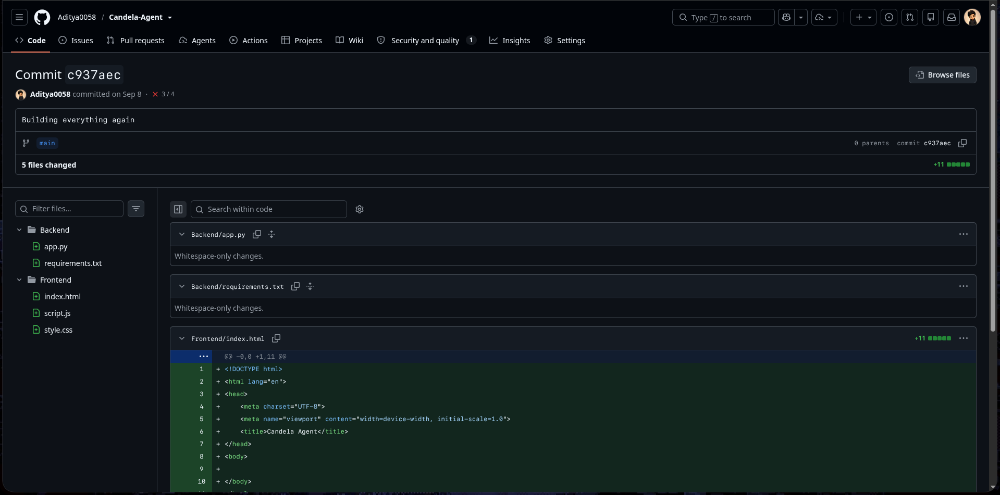

# 8 Sept 2026
## Initialization of project 

I deleted every static file and restarted my project in react in typescript

I was know that this is very new for me like in typescipt but still I thought I will learn while building
# 17 Oct 2026
## Starting journal in codebase
- I know that i am starting joural too late but no worries its never late to start
- Today I was building for giving my candela  a seperate chat ids and display them in sidebar - but I noticed that it is going very difficult to transfer data from here to there and I have seriously got out of my mind - thats why I think I should restructure my logic of backend